<div align="center">

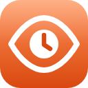

# EyeTime

**Focus, screen time and eye care for your browser.**<br>
Free, open source and 100% local — no account, no servers, no tracking.

[](LICENSE)
[](https://github.com/maxbzd/eyetime/actions/workflows/ci.yml)
[](PRIVACY.md)
[]()

[English](README.md) · [Русский](README_RU.md)

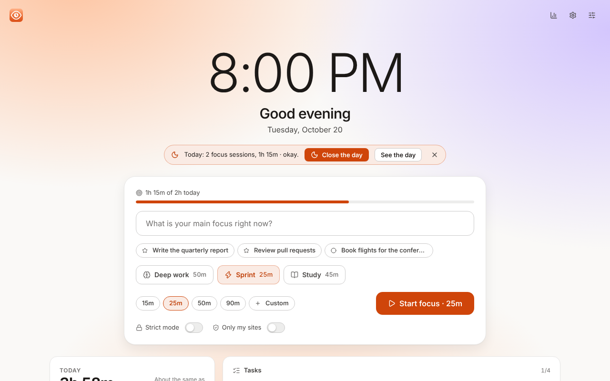

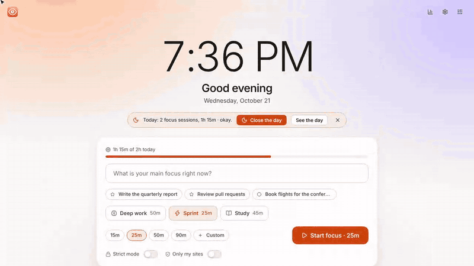

</div>

---

## Why EyeTime

Most blockers feel like punishment and most trackers feel like surveillance. EyeTime is built around three ideas:

1. **One click to focus.** Start a timed session from the toolbar, the new tab or a shortcut. Distracting sites pause until it ends.
2. **Honest, calm data.** See where your time really goes — per site, per hour, per day — with plain-language highlights. Empty means empty; nothing is invented.
3. **Friction, not force.** A breathing pause before a distracting site beats a lockout. Strict mode exists, but you choose it per session.

And because the name says it: it looks after your **eyes** too — 20-20-20 reminders counted in real screen time.

**Project page and privacy policy:** https://maxbzd.github.io/eyetime/ · Problems? *Settings → About → Report a problem* builds a short, private diagnostic text you can attach to an issue.

## Features

| | |
|---|---|
| 🎯 **Focus sessions** | 15 / 25 / 50 / 90 min or custom, optional goal text, soft start/end sound, optional *Strict* mode, "open my music" link. Distracting tabs are paused instantly and released automatically when the session ends. |
| 🛡 **Blocking that respects you** | Category presets (social, video, forums, news, games, shopping, messengers), your own sites, an allow-list, work-hours schedule, per-site daily limits, always-blocked list and a short breathing pause with a timed "continue". |
| 📊 **Insights** | Today / 7 / 30 days: screen time, focus time, distraction share, breaks. Stacked charts by day and hour, a calendar heatmap, a site table where one tap re-classifies a site (productive / neutral / distracting), highlights like "your most distracting day was Sunday", a **weekly review with a one-click limit suggestion**, CSV export, table view for accessibility. |
| ⏱ **Break timer** | After a session a rest countdown starts on its own (Pomodoro-style, configurable). Distracting sites stay open during the break. |
| 👁 **Eye care** | 20-20-20 reminders based on *active* screen time, a guided 20-second break page, break counter, bedtime nudge. |
| 🏠 **Home (new tab)** | Clock (7 styles), focus card with daily goal, today's summary, tasks with priorities, habits with streaks, notes, quick links; 17 backdrops or your own photo, 3 layouts, reorderable cards. Can be switched off. |
| 🎨 **Make it yours** | Eleven looks (Calm, Paper, Midnight, Terminal, Sakura, Forest, Aurora, Mono, Sunset, Nord, Ocean), any accent colour, fonts, corners, density, card style, light/dark/schedule, custom CSS and shareable looks. Contrast stays accessible. [Details](docs/THEMES.md). |
| 🧠 **Research-driven** | If-then plans on the pause page, ready-to-resume notes, a two-minute *Close the day* ritual, break ideas, your own best session length — each tied to published research (and honest about how strong it is): [docs/RESEARCH.md](docs/RESEARCH.md). |
| 🚀 **Productivity loop** | Plan (≤ 3 priorities) → focus on a task → rate the session → see your goal streak and **best focus hours**. "Only my sites" sessions, long breaks, focus reminders, intent-based pause page. |
| ⌨️ **Fast by keyboard** | `Ctrl/Cmd + K` command palette (start a mode, focus on a task, switch look, jump anywhere, add a task), quick-add tasks (`Report 14:30 45m !`), single-key shortcuts on Home. |
| 🗓 **Plan the day and the week** | *Plan my day* fits your priorities into the time you really have, recurring tasks (`every weekday`), three outcomes for the week, calendar by link or file (.ics) with a next-meeting line on the focus card, dates in plain words (`Report tomorrow 14:30 45m !`, `Call Friday`, in 9 languages), tasks in and out as Markdown or CSV. |
| 🔁 **Know yourself** | Estimate accuracy (planned vs actual), a day timeline with your focus sessions, focus time *by project* (`#tag` of the task), a *What pulls you* card (when and how long a site tempts you, one tap to limit it), a shareable *My week* card (totals only), optional settings sync across browsers. |
| 📱 **Short-video guard** | After a limit of Shorts / Reels / TikTok / VK Clips scrolling the page turns grayscale and pauses. Optional hiding of Shorts, recommendations, comments and the YouTube home feed. |
| 🌍 **11 languages** | English, Русский, Español, Deutsch, Français, Português, Italiano, Polski, Українська, 简体中文, 日本語. Key-based i18n; adding a language is one file ([how](docs/TRANSLATING.md)). |
| 🔒 **Private by design** | Only domain names and seconds are stored, on your device. [Details](PRIVACY.md). |

<details>
<summary><b>More screenshots</b></summary>

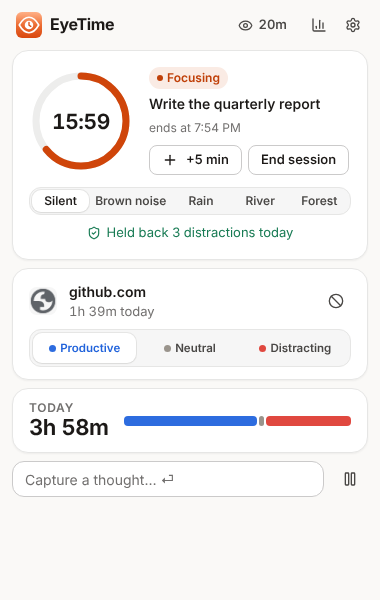
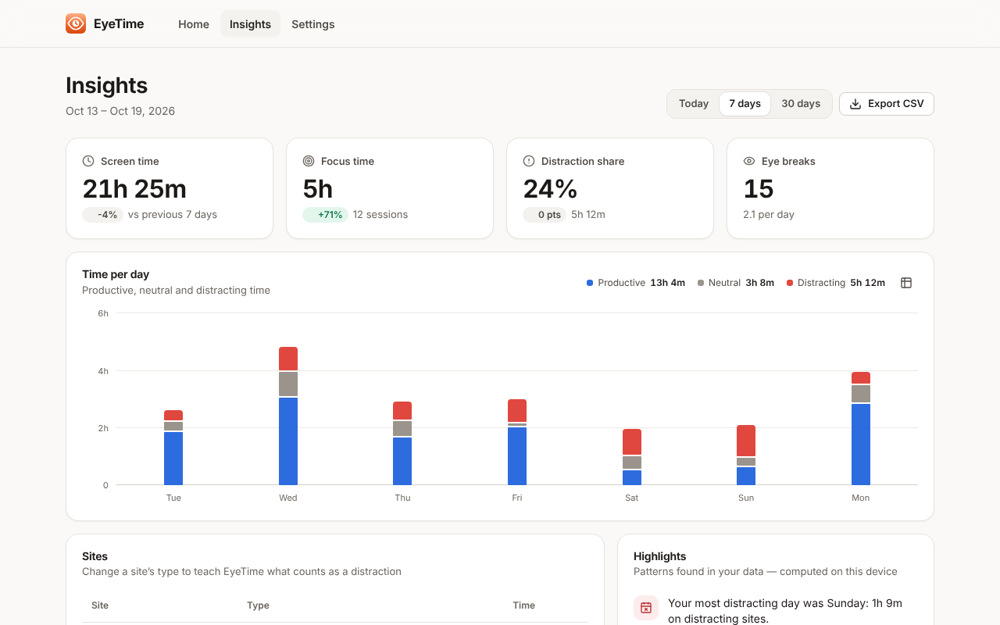
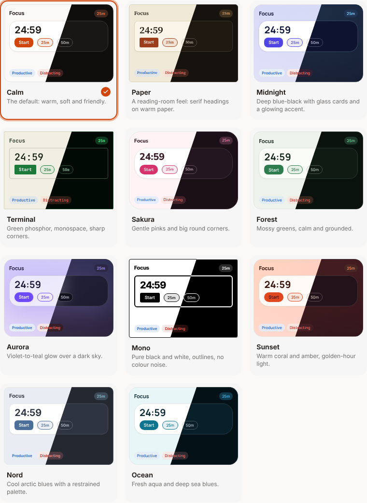
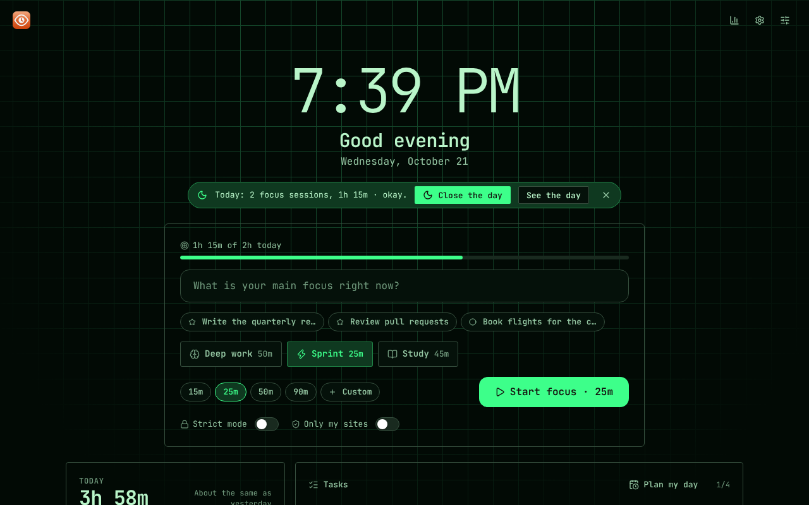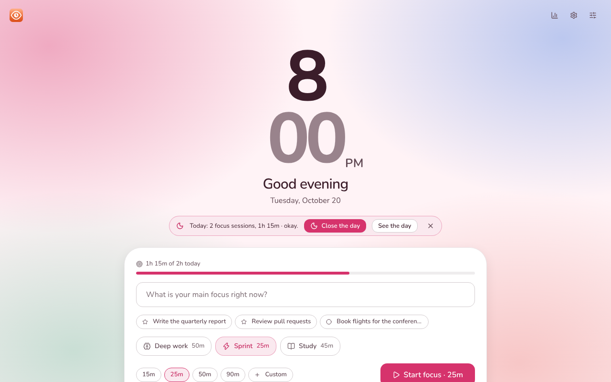
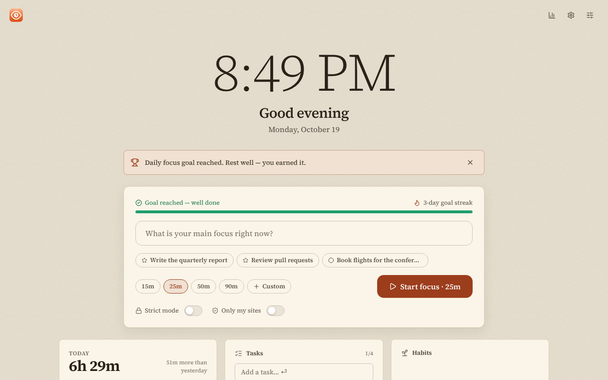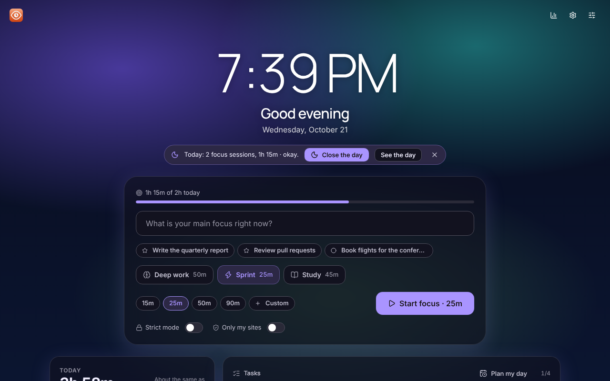
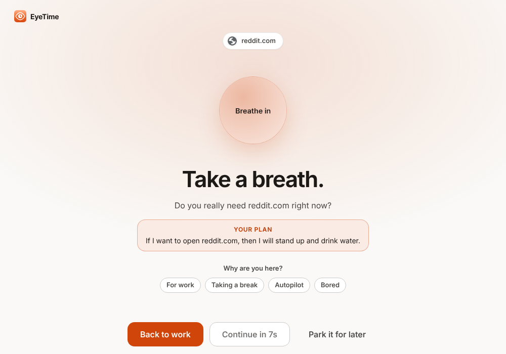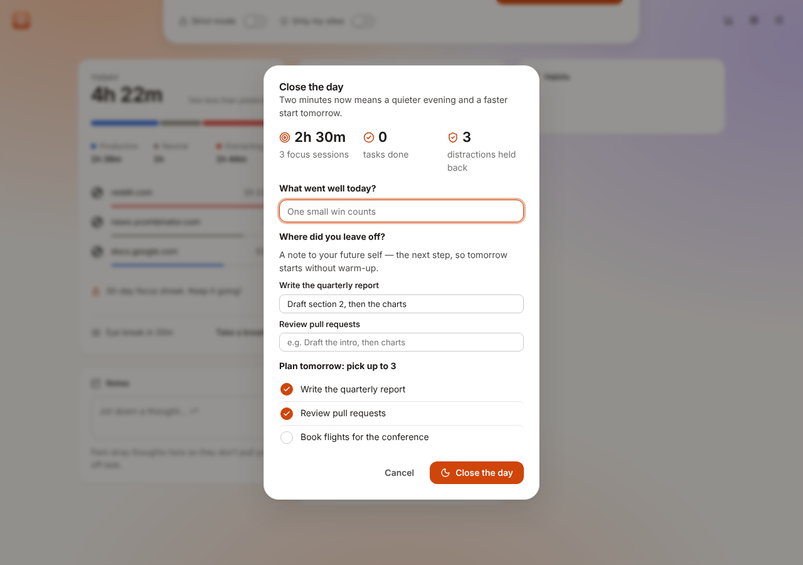
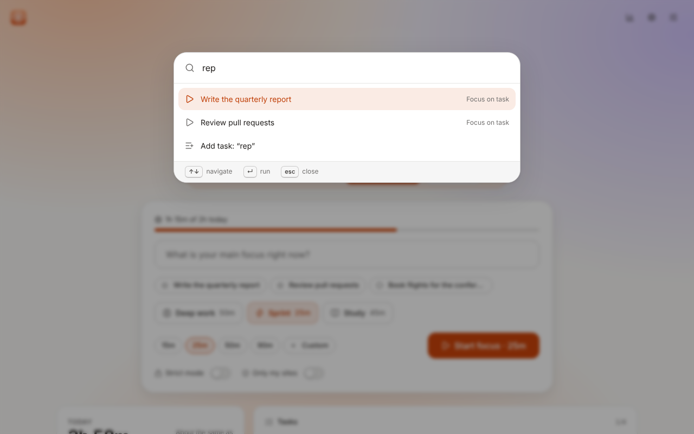
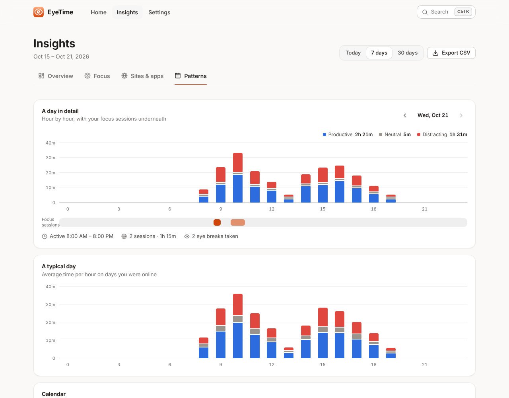
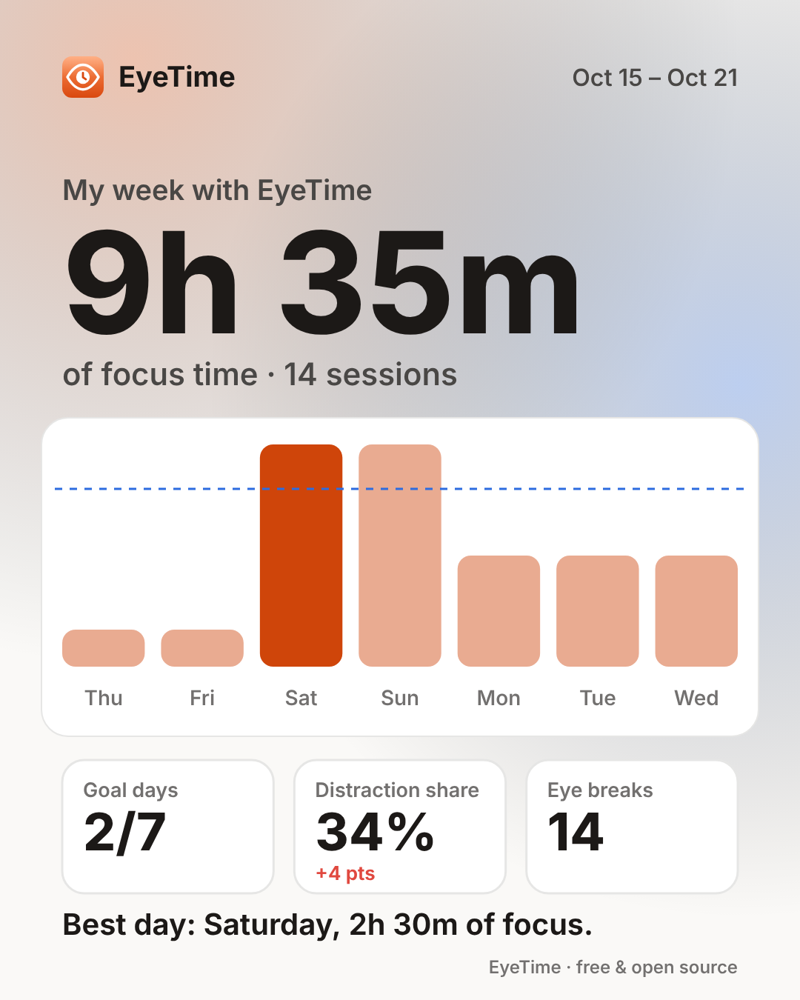
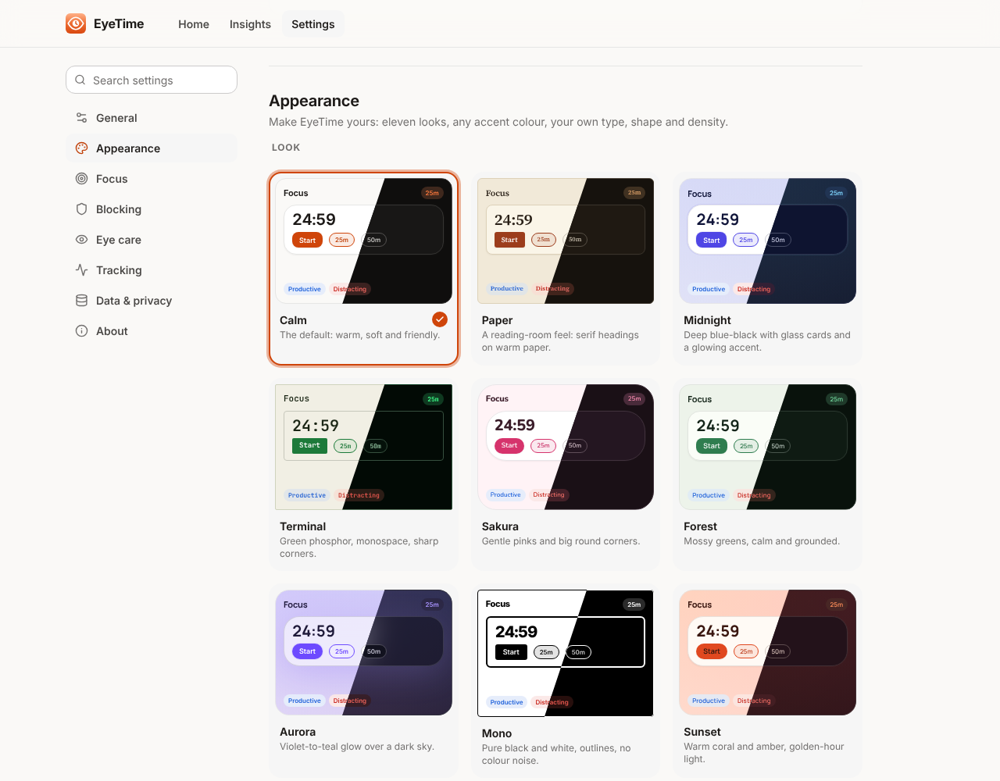
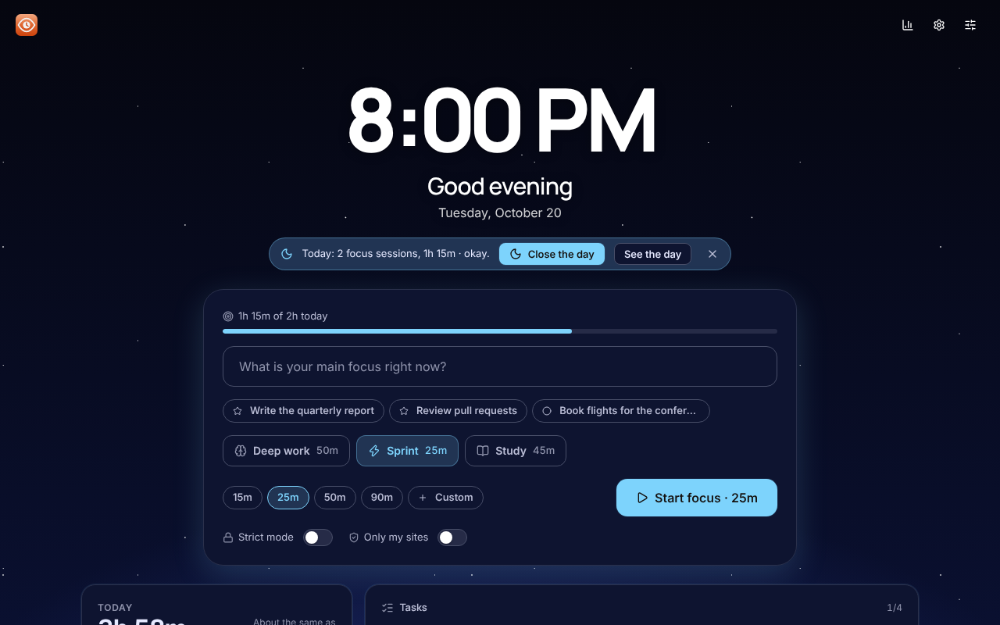
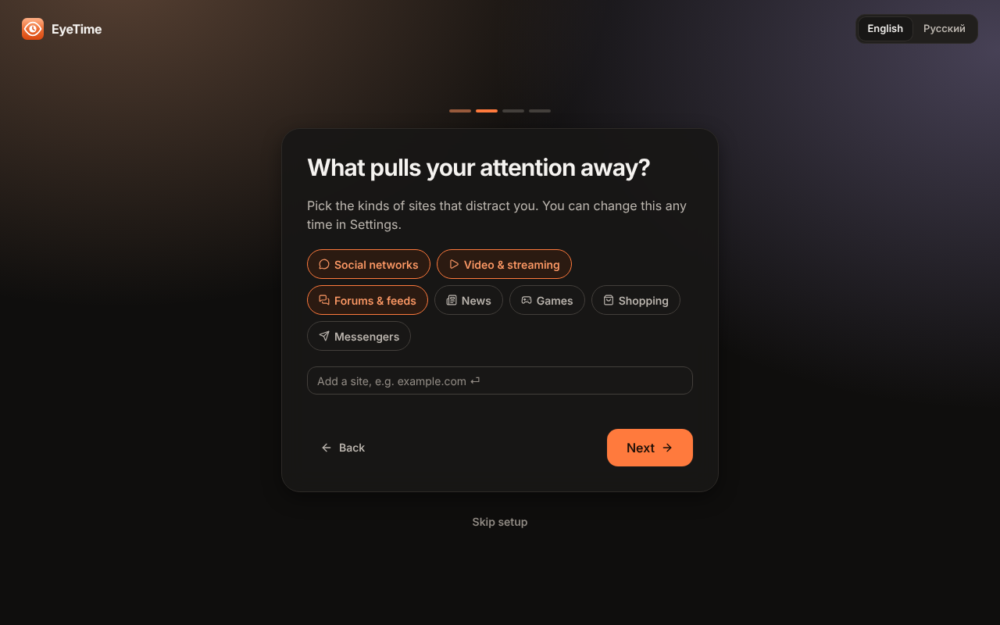

</details>

## Install

> EyeTime is not in the Chrome Web Store yet. Until it is, install it in a minute from a release or from source.

**Chrome, Edge, Brave, Arc (Chromium 120+)**

1. Download `eyetime-chrome.zip` from the [latest release](https://github.com/maxbzd/eyetime/releases) and unzip it — *or* `git clone https://github.com/maxbzd/eyetime.git` (no build step needed).
2. Open `chrome://extensions`, switch on **Developer mode**, click **Load unpacked** and select the folder that contains `manifest.json`.
3. The setup wizard opens. Pin EyeTime from the puzzle-piece menu so it is one click away.

**Firefox (121+)** — experimental: run `npm run build`, then `about:debugging` → *This Firefox* → *Load Temporary Add-on* → `dist/firefox/manifest.json`. (Sound and site icons are Chrome-only for now.)

> Updating from EyeTime 1.x? Your settings, tasks, habits, notes and history migrate automatically. See [what changed](docs/PRODUCT.md#1-audit-of-v11-why-a-redesign).

## Using it

- **Keyboard on Home:** `f` focus goal · `n` add a task · `d` close the day · `c` customize · `i` Insights · `s` Settings · `?` list. In Settings, `/` searches.
- **Start focus:** toolbar icon → type what you're working on → *Start focus*. Or press <kbd>Alt</kbd>+<kbd>Shift</kbd>+<kbd>F</kbd>.
- **Right-click any page → EyeTime** to mark or block the site, or start/stop focus.
- **Teach it what distracts you:** open the popup on any site and tap *Productive / Neutral / Distracting*. The same works per row in Insights.
- **Set limits:** Settings → Blocking → *Daily limits* (works for any site).
- **Rest your eyes:** a reminder appears after 20 minutes of active screen time; the break page walks you through 20 seconds.

## Privacy in one table

| Stored on your device | Never stored or sent |
|---|---|
| Domain names and seconds per hour | Page URLs, titles, content, keystrokes |
| Your settings, tasks, notes, habits | Anything about you — there is no account |
| (optional) per-app seconds from the desktop companion | Analytics, crash reports, ads — none |

Permissions are minimal and each one is explained in **Settings → Data & privacy**. The only network request EyeTime ever makes is to `127.0.0.1` if *you* enable the desktop companion. See [PRIVACY.md](PRIVACY.md).

## Desktop companion (optional)

A tiny read-only Windows helper that adds time spent in desktop apps. It only notes the front app's executable name, is protected by a pairing token and can never touch your browser. → [companion/README.md](companion/README.md)

## Project layout

```
manifest.json          MV3 manifest (Chrome/Edge; Firefox variant built by npm run build)
src/shared/            pure logic: time, domains, classify, blocking, stats, migrate, i18n, storage
src/background/        service worker: tracker, focus, blocker, eye breaks, weekly report
src/popup|newtab|insights|options|onboarding|blocked|break/   the seven surfaces
src/content/feed.js    short-video guard (only YouTube / Instagram / TikTok / VK)
src/ui/                design tokens, components, charts, icons (Lucide), Inter font
companion/             optional Windows desktop companion (Python, stdlib only)
docs/                  PRODUCT.md · DESIGN.md · THEMES.md · RESEARCH.md · ARCHITECTURE.md
scripts-dev/           checker, tests, icon + package builders
```

No framework, no bundler, no runtime dependencies — open the folder, read the code.

## Development

```bash
npm run check     # syntax, manifest, i18n parity, icons + unit tests (Node 22+)
npm run build     # dist/eyetime-chrome.zip and dist/eyetime-firefox.zip
python -m unittest -v test_companion   # in companion/
```

See [CONTRIBUTING.md](CONTRIBUTING.md) for the architecture tour, adding a language and the browser-level test.

## Roadmap

- [x] Redesign, light/dark themes, key-based i18n, safer desktop companion (2.0)
- [ ] Chrome Web Store, Edge Add-ons and Firefox AMO listings
- [x] Spanish, German, French and Portuguese (machine-translated — corrections welcome, see [docs/TRANSLATING.md](docs/TRANSLATING.md))
- [ ] More languages (UK, ZH, JA, IT, PL …) — [one file each](CONTRIBUTING.md#adding-a-language)
- [ ] macOS / Linux companion backends — [guide](companion/README.md#contributing-a-backend)
- [ ] In-app weekly review

## License

[MIT](LICENSE). Fonts: Inter (SIL OFL 1.1). Icons: Lucide (ISC). Both are bundled locally — EyeTime loads nothing from the internet.
