<div align="center">


# EyeTime

**Фокус, экранное время и забота о глазах — прямо в браузере.**<br>
Бесплатно, исходный код можно читать и проверять, и всё локально: без аккаунта, без серверов, без слежки.

[](LICENSE)
[](https://github.com/maxbzd/eyetime/actions/workflows/ci.yml)
[](PRIVACY.md)

[English](README.md) · [Русский](README_RU.md)

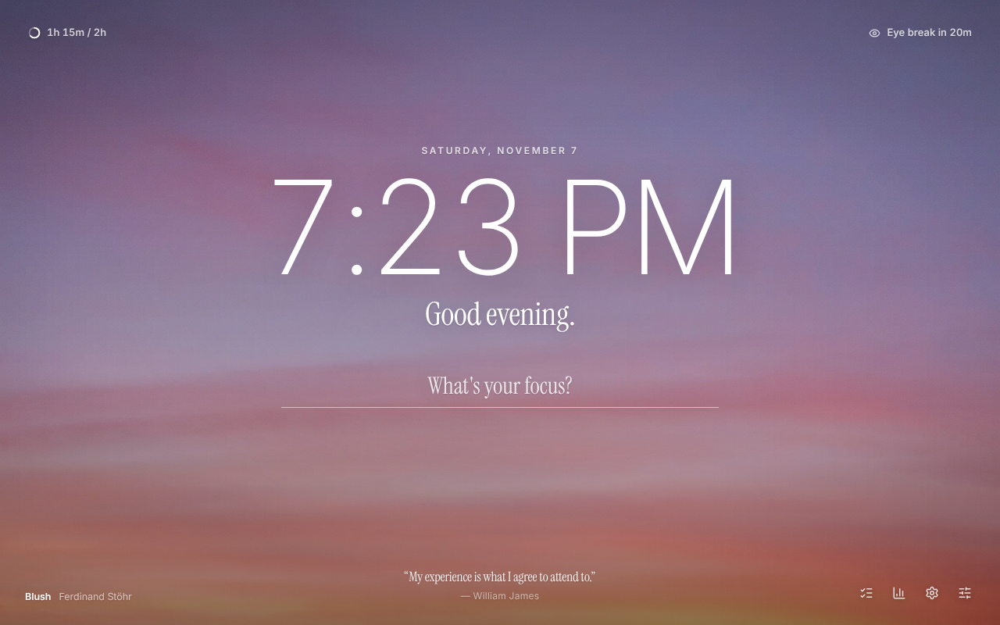

<a href="https://maxbzd.github.io/eyetime/#demo">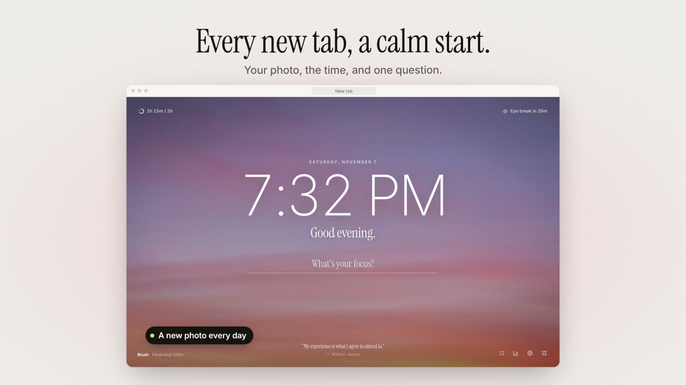</a>

▶ **Смотреть демо (36 секунд)** на [странице проекта](https://maxbzd.github.io/eyetime/#demo)

</div>

---

## Зачем EyeTime

Большинство блокировщиков похожи на наказание, а трекеры — на слежку. EyeTime построен на трёх идеях:

1. **Фокус в один клик.** Запускайте сессию по таймеру из панели браузера, новой вкладки или сочетанием клавиш. Отвлекающие сайты ставятся на паузу до её конца.
2. **Честные и спокойные данные.** Куда на самом деле уходит время — по сайтам, часам и дням, с понятными выводами. «Пусто» значит пусто, ничего не выдумывается.
3. **Лёгкое торможение, а не запрет.** Дыхательная пауза перед отвлекающим сайтом лучше блокировки. Строгий режим есть, но вы выбираете его для каждой сессии отдельно.

И, как следует из названия, он заботится о **глазах**: напоминания 20-20-20 по реальному времени у экрана.

## Возможности

| | |
|---|---|
| 🎯 **Фокус-сессии** | 15 / 25 / 50 / 90 ​​​‌‌‌‌‌‌‌‌‌‌​‌‌минут или своё значение, цель сессии, мягкий звук старта и конца, необязательный *строгий режим*, ссылка «включить мою музыку». Отвлекающие вкладки встают на паузу мгновенно и сами возвращаются, когда сессия закончилась. |
| 🛡 **Блокировка с уважением** | Категории (соцсети, видео, форумы, новости, игры, покупки, мессенджеры), свои сайты, белый список, расписание рабочих часов, дневные лимиты по сайтам, список «всегда блокировать» и короткая дыхательная пауза с отсчётом «продолжить». |
| 📊 **Статистика** | Сегодня / 7 / 30 дней: экранное время, время в фокусе, доля отвлечений, перерывы. Графики по дням и часам, календарь-тепловая карта, таблица сайтов, где одним касанием меняется тип сайта (полезный / нейтральный / отвлекающий), выводы вроде «самый отвлекающий день — воскресенье», **недельный обзор с лимитом в один клик**, экспорт CSV и табличный вид для доступности. |
| ⏱ **Таймер перерыва** | После сессии сам запускается отсчёт отдыха (в духе Pomodoro, настраивается). Во время перерыва отвлекающие сайты открыты. |
| 👁 **Забота о глазах** | Напоминания 20-20-20 по *активному* времени у экрана, страница-перерыв на 20 секунд, счётчик перерывов, напоминание об отбое. |
| 🏠 **Главная (новая вкладка)** | Спокойные обои, которые меняются каждый день (14 фотографий или свои), крупные тонкие часы, засечковое приветствие и **одна строка: на чём вы сосредоточены?** — нажмите Enter, и сессия началась, а часы превращаются в обратный отсчёт. Цель дня и ближайший перерыв для глаз — в углах; задачи с приоритетами, привычки с сериями, заметки и быстрые ссылки открываются в стеклянной панели (клавиша `N`). Остались три других раскладки (по центру, разделённая, минимальная) и свободный редактор. Можно отключить. |
| 🎨 **Настройте под себя** | 16 стилей, любой акцентный цвет, шрифты, скругления, плотность, стиль карточек, светлая/тёмная/по расписанию, свой CSS и обмен стилями. Контраст всегда читаемый. [Подробнее](docs/THEMES.md). |
| 🧠 **На основе исследований** | Планы «если — то» на странице паузы, заметки «где остановился», ритуал «Закрыть день» на две минуты, идеи для перерывов, ваша лучшая длина сессии — каждое связано с исследованиями (и честно говорит, насколько они надёжны): [docs/RESEARCH.md](docs/RESEARCH.md). |
| 🚀 **Цикл продуктивности** | План (до 3 приоритетов) → фокус на задаче → оценка сессии → серия по цели и **лучшие часы фокуса**. Режим «только мои сайты», длинные перерывы, напоминания, осознанная страница паузы. |
| 🗓 **План дня и недели** | «План на сегодня» умещает приоритеты в реальное время, повторяющиеся задачи (`по будням`), три результата недели, календарь по ссылке или файлом (.ics) со строкой «следующая встреча» на карточке фокуса, даты словами (`Отчёт завтра 14:30 45м !`, `позвонить в пятницу`, на 11 языках), задачи туда и обратно в Markdown и CSV. |
| 🔎 **Узнайте себя** | Точность оценок (план/факт), таймлайн дня, время фокуса *по проектам* (`#тег` задачи), карточка «Что вас тянет» (когда и насколько сайт затягивает, лимит в одно касание), карточка «Моя неделя» (только итоги), синхронизация настроек. |
| 📱 **Защита от коротких видео** | После лимита скролла Shorts / Reels / TikTok / VK Клипов страница становится чёрно-белой и встаёт на паузу. Можно скрыть Shorts, рекомендации, комментарии и главную ленту YouTube. |
| 🌍 **11 языков** | Русский, English, Español, Deutsch, Français, Português, Italiano, Polski, Українська, 中文, 日本語. i18n по ключам; новый язык — один файл ([как](docs/TRANSLATING.md)). |
| 🔒 **Приватность по умолчанию** | Хранятся только доменные имена и секунды, на вашем устройстве. Две необязательные парольные фразы: одна запечатывает токены подключённых сервисов, другая шифрует синхронизируемые настройки и задачи на устройстве, так что в облаке аккаунта браузера лежит только шифртекст. [Подробнее](PRIVACY.md), [модель угроз](SECURITY.md). |
| ⚡ **Мгновенная блокировка** *(необязательно, Chrome)* | Сам браузер отправляет отвлекающую вкладку на страницу паузы до единого запроса (настоящий сервер насчитал 1 запрос без неё и 0 с ней). По умолчанию выключена; при включении просит доступ к сайтам. |

<details>
<summary><b>Больше скриншотов</b></summary>

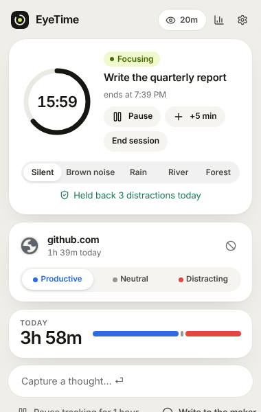
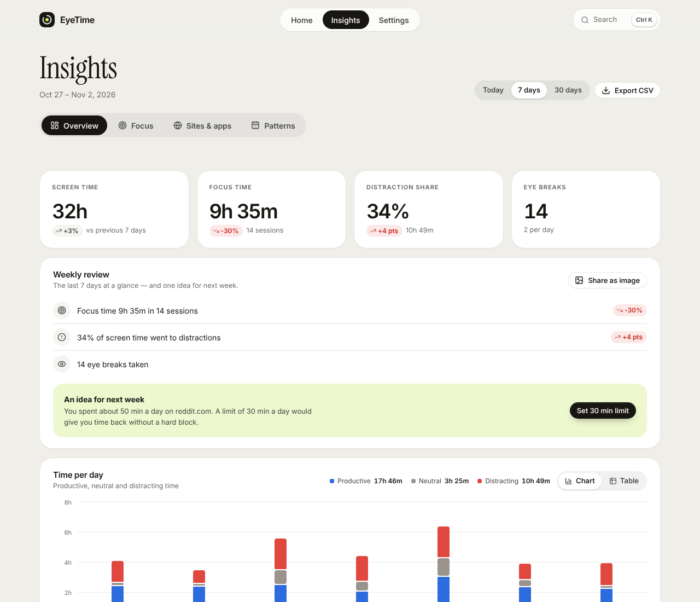
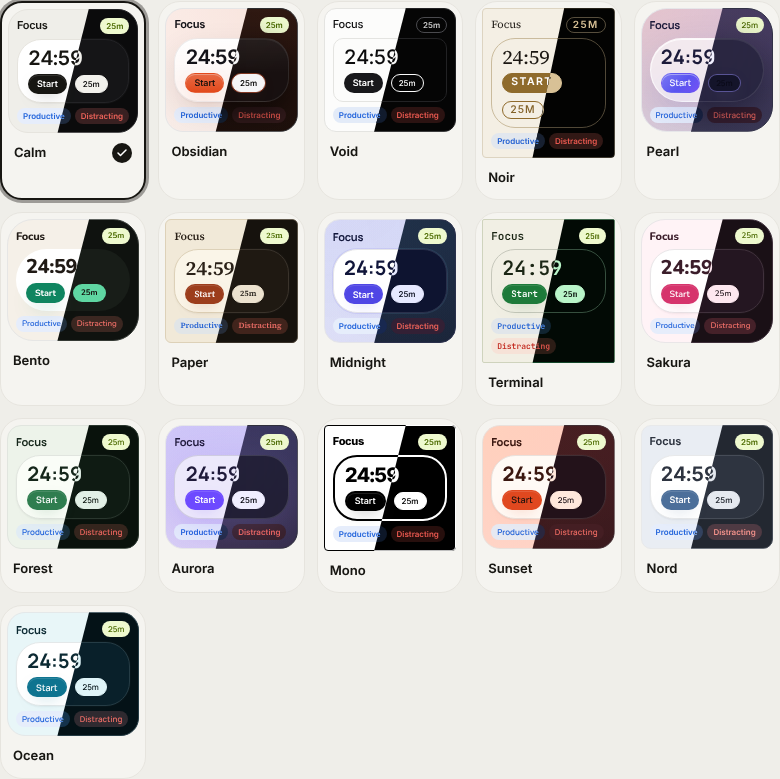
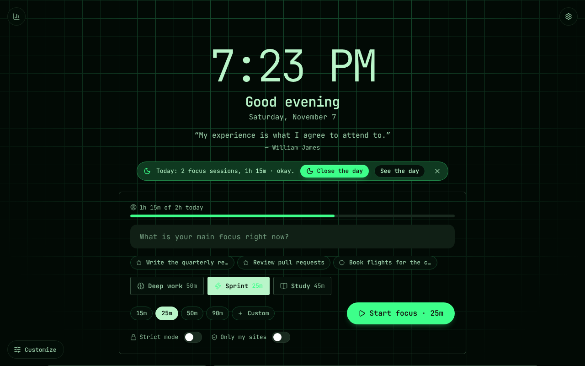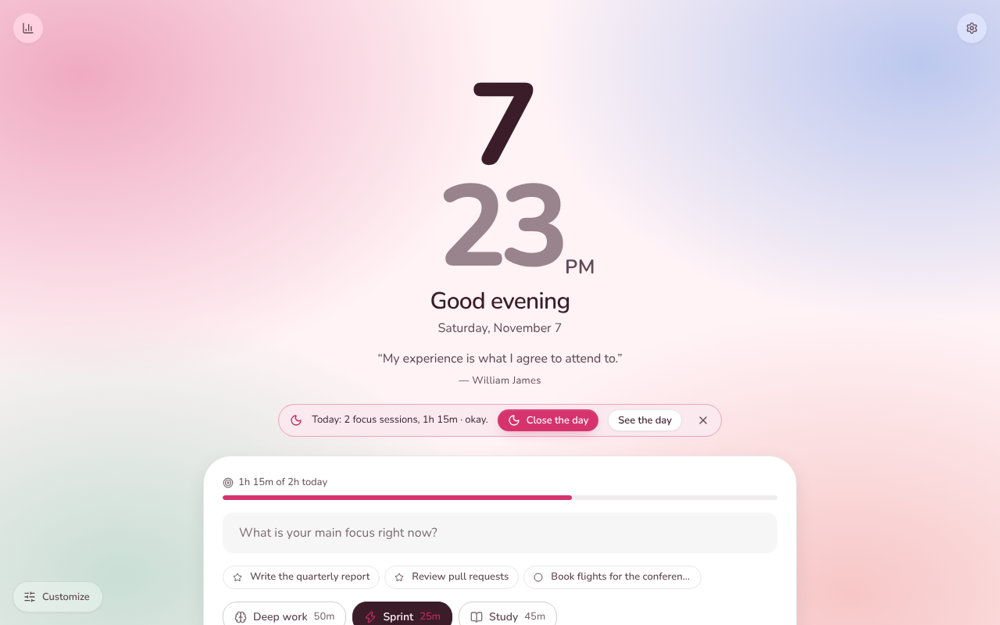
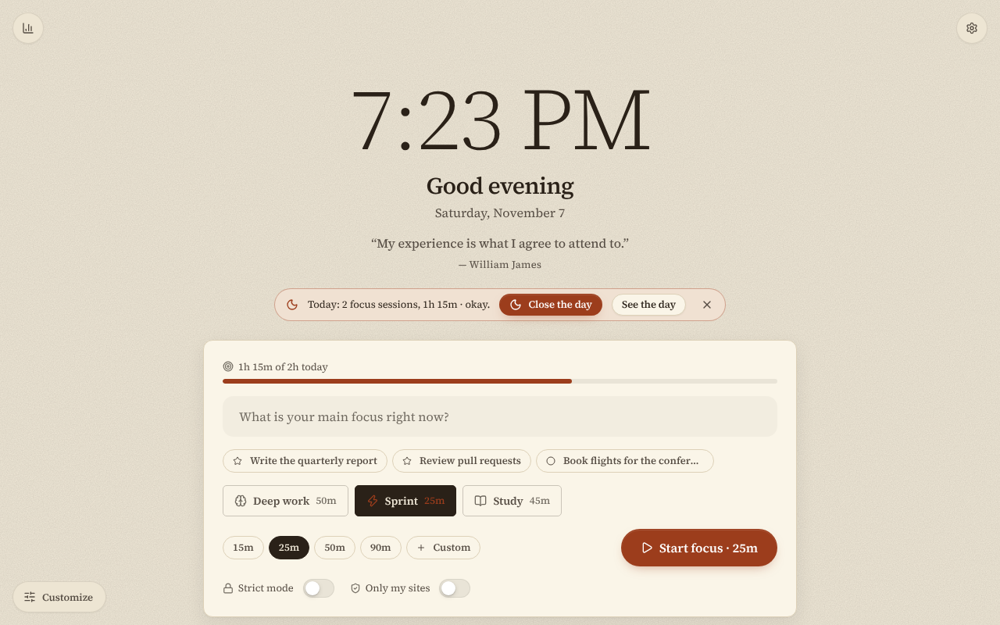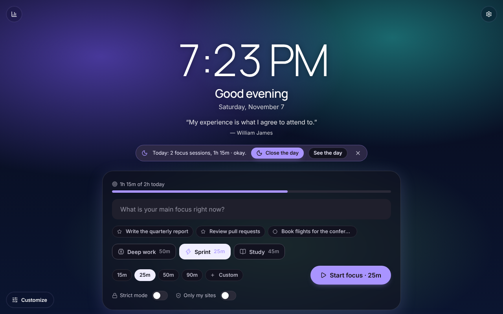
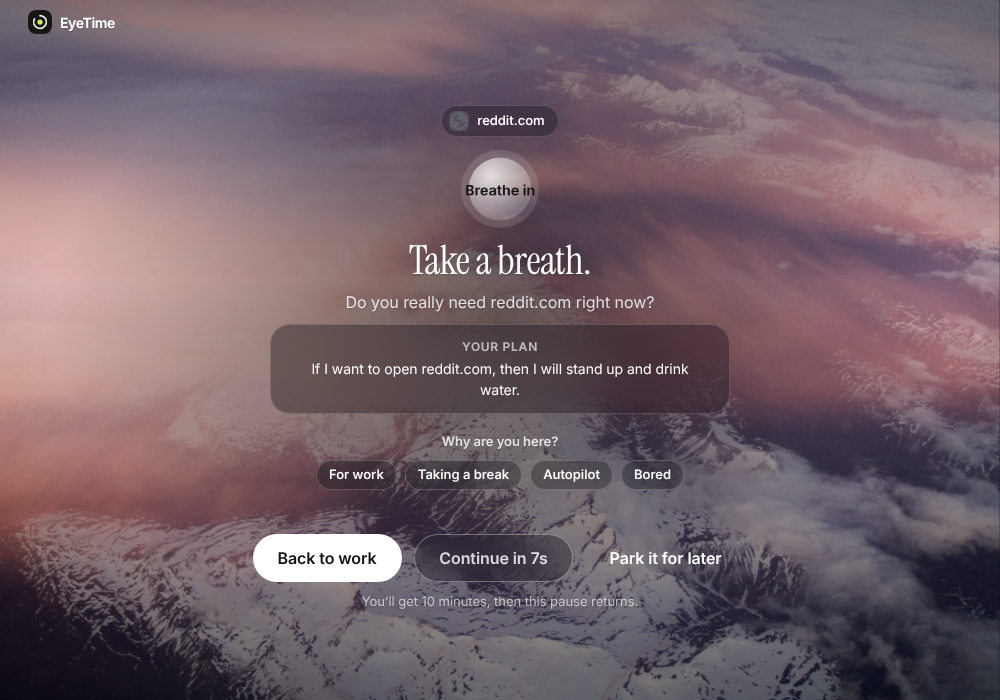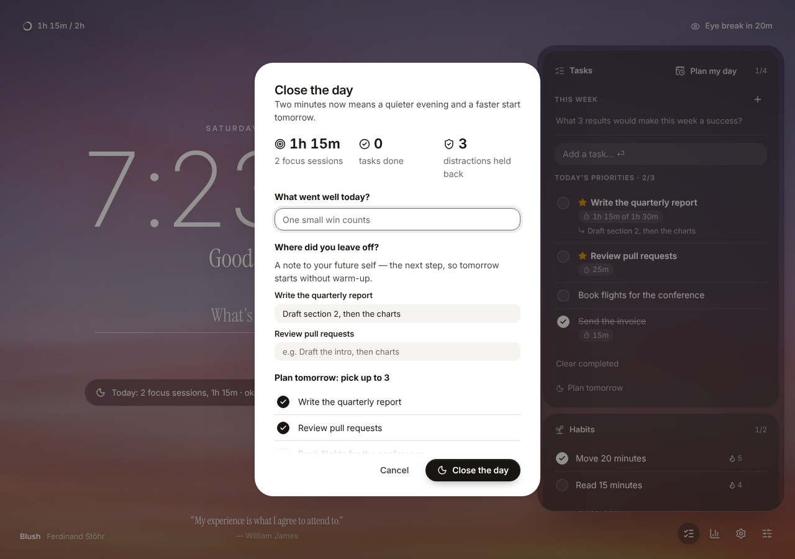
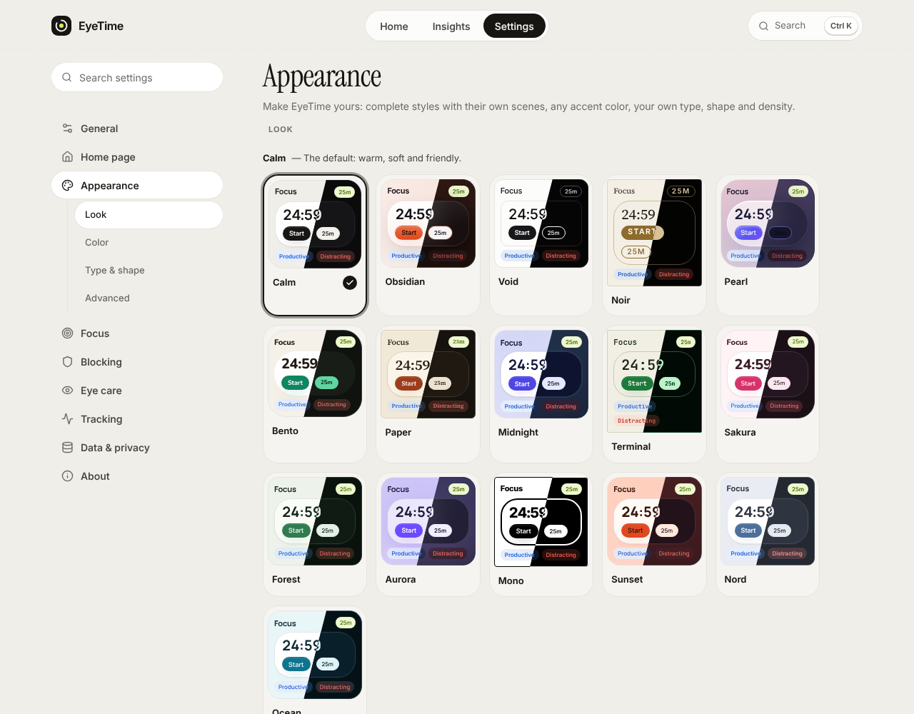
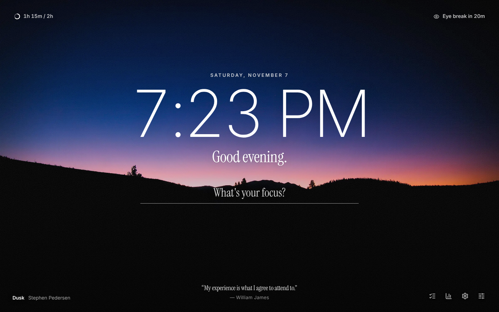
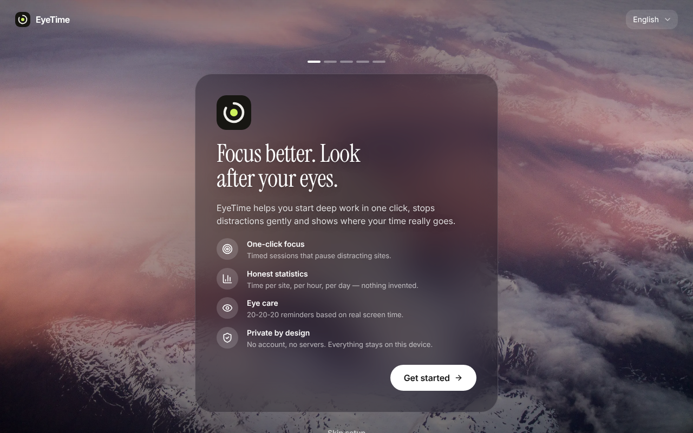
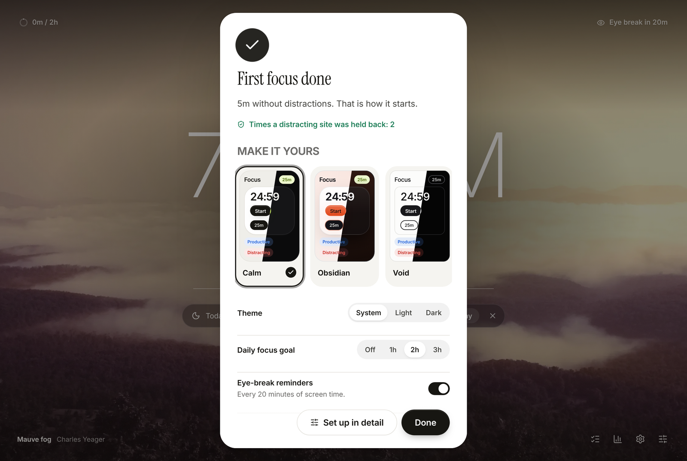

</details>

## Установка

> EyeTime пока нет в Chrome Web Store. До публикации установка занимает минуту — из релиза или из исходников.

**Chrome, Edge, Brave, Arc (Chromium 120+)**

1. Скачайте `eyetime-chrome.zip` из [последнего релиза](https://github.com/maxbzd/eyetime/releases) и распакуйте — *или* `git clone https://github.com/maxbzd/eyetime.git` (сборка не нужна).
2. Откройте `chrome://extensions`, включите **Режим разработчика**, нажмите **Загрузить распакованное расширение** и выберите папку, где лежит `manifest.json`.
3. Откроется мастер настройки. Закрепите EyeTime через меню с пазлом, чтобы он был под рукой.

**Firefox (121+)** — экспериментально: `npm run build`, затем `about:debugging` → *Этот Firefox* → *Загрузить временное дополнение* → `dist/firefox/manifest.json`. (Звук и значки сайтов пока работают только в Chrome.)

> Обновляетесь с EyeTime 1.x? Настройки, задачи, привычки, заметки и история переносятся автоматически. [Что изменилось](docs/PRODUCT.md#1-audit-of-v11-why-a-redesign).

## Как пользоваться

- **Клавиши на главной:** `f` цель фокуса · `n` задача · `d` закрыть день · `c` настроить · `i` статистика · `s` настройки · `?` список. В настройках `/` — поиск.
- **Запустить фокус:** значок в панели → напишите, над чем работаете → *Начать фокус*. Или <kbd>Alt</kbd>+<kbd>Shift</kbd>+<kbd>F</kbd>.
- **Правый клик по странице → EyeTime**: отметить или заблокировать сайт, запустить/остановить фокус.
- **Научить, что отвлекает:** откройте popup на любом сайте и нажмите *Полезный / Нейтральный / Отвлекающий*. То же — в каждой строке статистики.
- **Задать лимиты:** Настройки → Блокировка → *Дневные лимиты* (для любого сайта).
- **Отдохнуть глазам:** напоминание приходит после 20 минут активного времени у экрана; страница-перерыв проведёт вас через 20 секунд.

## Приватность в одной таблице

| Хранится на вашем устройстве | Никогда не хранится и не отправляется |
|---|---|
| Доменные имена и секунды по часам | Адреса страниц, заголовки, содержимое, нажатия клавиш |
| Ваши настройки, задачи, заметки, привычки | Что-либо о вас — аккаунта нет |
| (по желанию) секунды по приложениям от десктопного помощника | Аналитика, отчёты об ошибках, реклама — ничего |

Разрешения минимальны, каждое объяснено в **Настройки → Данные и приватность**. EyeTime не делает собственных сетевых запросов. Обращаются в сеть только четыре вещи, которые вы включаете сами, и только по адресу, который вы указали: десктопный помощник (`127.0.0.1`), подключённый сервис (Todoist, Notion, CalDAV: собственный адрес сервиса, прямо из вашего браузера), подписка на календарь (ссылка на ваш календарь, раз в час) и необязательная погода (Open-Meteo, бесплатный сервис без аккаунтов; уходят только округлённые координаты выбранного города). Ещё одно — необязательные анонимные числа раз в неделю и сообщения автору: они уходят только после вашего «да» или когда вы сами нажмёте «Отправить», и только если в сборке есть адрес сборщика (в первом публичном выпуске его нет). См. [PRIVACY.md](PRIVACY.md).

## Десктопный помощник (необязательно)

Маленькая утилита для Windows, только чтение: добавляет время в приложениях на компьютере. Она запоминает лишь имя исполняемого файла активного окна, защищена токеном и никак не влияет на браузер. → [companion/README.md](companion/README.md)

## Разработка

```bash
npm run check     # синтаксис, манифест, полнота переводов, иконки + 15 юнит-тестов (Node 20+)
npm run build     # dist/eyetime-chrome.zip и dist/eyetime-firefox.zip
```

Подробности — в [CONTRIBUTING.md](CONTRIBUTING.md). Продуктовое обоснование редизайна — [docs/PRODUCT.md](docs/PRODUCT.md), система дизайна — [docs/DESIGN.md](docs/DESIGN.md), устройство — [docs/ARCHITECTURE.md](docs/ARCHITECTURE.md).

## Планы

- [x] Редизайн, светлая/тёмная темы, i18n по ключам, безопасный десктопный помощник (2.0)
- [ ] Публикация в Chrome Web Store, Edge Add-ons и Firefox AMO
- [ ] Новые языки (ES, DE, PT, UK, ZH …) — [по одному файлу](CONTRIBUTING.md#adding-a-language)
- [ ] Помощник для macOS / Linux — [инструкция](companion/README.md#contributing-a-backend)
- [ ] Недельный обзор внутри приложения

## Лицензия

[FSL-1.1-ALv2](LICENSE) (Functional Source License: код можно читать, запускать, менять и распространять для любых целей, кроме создания конкурирующего коммерческого продукта; через два года каждая версия становится Apache 2.0; название и логотип не лицензируются; см. [NOTICE](NOTICE)). Шрифт Inter (SIL OFL 1.1), иконки Lucide (ISC) — оба лежат внутри расширения: EyeTime ничего не загружает из интернета.

## Связь

Вопросы, идеи, проблемы: [issues](https://github.com/maxbzd/eyetime/issues), <maxbzd1600@gmail.com> или Telegram [@maxbzd](https://t.me/maxbzd). Уязвимость: см. [SECURITY.md](SECURITY.md).
